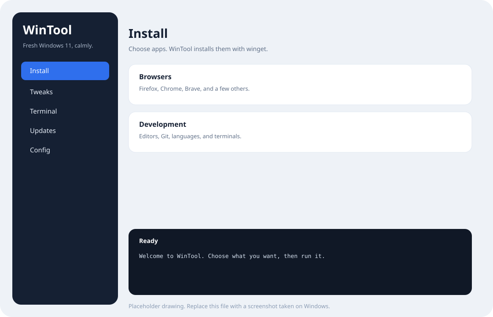

# WinTool

WinTool is a small, friendly helper for a fresh Windows 11 PC. It installs and updates the apps you pick, applies optional tweaks, sets up a developer terminal, scans and backs up drivers, runs common repairs, and manages Windows Update, optional features, DNS, and the power plan.

It is an independent project by [Henrique](https://github.com/Hinrikao). It is not made by Microsoft, and it is not a copy of any other Windows utility.

The window is meant to be calm: nothing is installed until you ask, every tweak can be undone, and a restore point is created before tweaks are applied.



That image is a placeholder. Replace `docs/screenshots/placeholder.svg` with a PNG taken on Windows when you have one.

## What you can do

- **Home.** Checks junk files, recommended tweaks, startup programs, device status, and drive health without changing anything until you ask, and shows live memory, disk, and PC hardware details.
- **Install.** A searchable checklist of about 175 apps, grouped into browsers, communication, development, gaming, media, office and notes, security and network, runtimes, and utilities. WinTool installs the ones you tick with [winget](https://learn.microsoft.com/windows/package-manager/winget/). In the background it checks which apps are already installed and which have an update, and marks them **Installed** or **Update available**. You can select the installed ones, update or uninstall the ticked apps (or one app from its right-click menu), and upgrade everything winget knows about.
- **Tweaks.** About 70 Windows settings for File Explorer, the taskbar and Start, appearance, privacy, search, input, gaming, and system behavior. Every tweak has an undo. Presets named Minimal and Recommended select a starting set. Stronger changes are marked Caution and stay off until you choose them.
- **Terminal.** Windows Terminal, PowerShell 7, either Oh My Posh or Starship, a Nerd Font, optional Terminal-Icons, and optional Ubuntu with zsh and Oh My Zsh.
- **Drivers.** Simple, Advanced, and Tools views to scan this PC with Windows Update, update only what you choose, inspect a device, back up or restore drivers, and repair audio, problem codes, leftover entries, the network, display resolution, game runtimes, and incompatible drivers. Simple mode only flags recommended game runtimes (current Visual C++, DirectX, and OpenAL), plus updates for packages already installed. A restore point is created before installs when System Protection is on. WinTool uses official sources only and does not install driver-booster tools. A slim status bar and an Activity panel replace the old log in every tab; the log file is still written in the background.
- **Updates.** Choose an update mode: Default, Security updates only (feature updates wait 365 days, no automatic restart while signed in), or Disabled. **Back to default** removes everything WinTool set. You can also scan Windows Update for driver updates, open Windows Update and optional updates, and open the NVIDIA, AMD, or Intel download page. A full driver scan and backup live on the Drivers tab. WinTool does not install driver-booster tools.
- **Fixes.** Reset Windows Update, reset the network stack, repair system files with DISM and SFC, and repair winget. Each asks first and logs what it runs.
- **Features.** Turn optional Windows features on or off: Hyper-V, Windows Sandbox, .NET Framework 3.5, WSL, Virtual Machine Platform, and more. The tab shows the current state and reminds you to restart.
- **Config.** Save your ticks to a JSON profile and load them next time, and export or import winget's own package list. Pick the DNS servers for a network adapter (Automatic, Cloudflare, Google, Quad9, or AdGuard, with IPv6), and add or remove the Ultimate Performance power plan.

## Requirements

- Windows 11
- PowerShell 5.1, which is already on Windows, or PowerShell 7
- An administrator account. WinTool asks Windows to elevate if the window is not already elevated
- winget (App Installer). Current Windows 11 installs include it. If it is missing, install **App Installer** from the Microsoft Store

## Run it

Open PowerShell and paste:

```powershell
irm https://raw.githubusercontent.com/Hinrikao/WinTool/main/wintool.ps1 | iex
```

Approve the administrator prompt. The WinTool window opens in a dark theme. The log stays collapsed until a task is running, or until you press Show log.

Only the WinTool window stays on screen after it opens. A classic console is hidden and comes back with a short summary when you close WinTool. A Windows Terminal window with one tab is hidden the same way and restored on close; if that window has other tabs, only the launching tab closes. The app itself starts with no extra terminal tab. On Windows PowerShell 5.1, WinTool can offer to install PowerShell 7 and Windows Terminal, and it prefers PowerShell 7 for the window when that is already present. Add `-ShowConsole` to `wintool.ps1` or `src\Start-WinTool.ps1`, or set `WINTOOL_SHOW_CONSOLE=1` before the one-liner, to keep the console for debugging.

If startup fails, the message stays on screen and the details are appended to `%TEMP%\WinTool\wintool.log`.

The Terminal tab has a Simple recommendation and an Advanced chooser. Advanced searches the Nerd Fonts catalog and the official Oh My Posh themes, and can refresh both lists from GitHub.

With WSL selected, an Ubuntu that already exists is kept: WinTool installs zsh and the prompt inside it as root (no sudo password), makes zsh the default shell, manages one marked block in `~/.zshrc` with a dated backup when it changes, and sets the Nerd Font on the Ubuntu profile in Windows Terminal. To run only that part from a clone of this repository:

```powershell
powershell -NoProfile -ExecutionPolicy Bypass -File .\tools\Invoke-WinToolWslSetup.ps1 -Distro Ubuntu
```

To run a copy you already downloaded:

```powershell
powershell -STA -NoProfile -ExecutionPolicy Bypass -File .\wintool.ps1
```

### Use the same setup after the next format

1. In WinTool, tick the apps and tweaks you want. On the Terminal tab, leave "Include this terminal setup when a saved profile is replayed" checked if you want that too.
2. Open **Config** and choose **Save profile**.
3. Keep that JSON file somewhere you can get to after formatting (a USB drive or cloud folder is enough).
4. After Windows is installed again, run:

```powershell
powershell -STA -NoProfile -ExecutionPolicy Bypass -File .\wintool.ps1 -ApplyProfile .\wintool-profile.json -Unattended
```

Unattended mode creates a restore point, applies the saved tweaks, runs the saved terminal setup when the profile says to, and installs the saved apps. It stops the tweak step if the restore point cannot be created.

Loading a profile from the Config tab only selects the boxes. It does not install anything until you press a button.

## Add an app

Edit `data/apps.json`. Each app needs a unique `id`, a `name`, a short `description`, and the `wingetId` from `winget search`.

```json
{
  "id": "firefox",
  "name": "Firefox",
  "description": "A fast browser from Mozilla, with strong tracking protection.",
  "wingetId": "Mozilla.Firefox",
  "tags": ["web", "privacy"]
}
```

Put it in the category that fits. Optional `scope` is `user` or `machine` when a package needs one. Optional `icon` is the file name of a PNG in `assets/icons/`, such as `firefox.png`. Leave it out to keep the colored letter tile. Then rebuild `wintool.ps1` (see below) so the one-line installer picks up the change.

Check the id before you publish it:

```powershell
winget search "Firefox"
winget show --id Mozilla.Firefox
```

## Add a tweak

Edit `data/tweaks.json`. A tweak needs `id`, `name`, `description`, `category`, `risk` (`safe` or `caution`), `refresh` (`none`, `theme`, or `explorer`), `presets`, `apply`, and `undo`.

WinTool does not run arbitrary script from the JSON file. An action is one of:

| type | what it does |
| --- | --- |
| `registry` | Sets registry values under `HKCU:` or `HKLM:` |
| `registry-remove` | Removes registry values |
| `registry-key` | Adds or removes one key. `add` can set the default value |
| `service` | Sets a service startup type. `startupType` is `Automatic`, `Manual`, or `Disabled` |
| `scheduled-task` | Enables or disables one scheduled task |
| `appx` | Removes inbox apps for the current user |
| `appx-restore` | Tries to register those apps again from the copy Windows still has |
| `group` | Runs several of the actions above |

Example:

```json
{
  "id": "show-file-extensions",
  "name": "Show file extensions",
  "description": "Always show extensions such as .pdf and .exe.",
  "category": "Explorer",
  "risk": "safe",
  "refresh": "explorer",
  "presets": ["minimal", "recommended"],
  "apply": {
    "type": "registry",
    "entries": [
      {
        "path": "HKCU:\\Software\\Microsoft\\Windows\\CurrentVersion\\Explorer\\Advanced",
        "name": "HideFileExt",
        "value": 0,
        "kind": "DWord"
      }
    ]
  },
  "undo": {
    "type": "registry",
    "entries": [
      {
        "path": "HKCU:\\Software\\Microsoft\\Windows\\CurrentVersion\\Explorer\\Advanced",
        "name": "HideFileExt",
        "value": 1,
        "kind": "DWord"
      }
    ]
  }
}
```

`refresh` of `explorer` restarts File Explorer when that checkbox is on. `theme` broadcasts a setting change so dark mode can apply immediately.

To put a tweak in a preset, add the preset id to its `presets` array. Preset names live at the top of `tweaks.json`.

## Build the single script

The files under `src/`, `data/`, and `assets/` are what you edit. `wintool.ps1` is generated so it can be launched with one command and does not need the rest of the repository beside it.

From the repository root:

```powershell
./build/Build-WinTool.ps1
```

Commit the updated `wintool.ps1` with your source change. CI fails if the committed launcher does not match the source.

While you are editing on Windows you can skip the build and run the source tree:

```powershell
powershell -STA -NoProfile -ExecutionPolicy Bypass -File .\src\Start-WinTool.ps1
```

## Safety

- Run WinTool only from a copy you trust. The one-line command downloads the script and runs it.
- Installing an app accepts that vendor's package agreements through winget.
- Tweaks change your user account and, for a few of them, the PC. Read the description. Caution means the change is still reversible but easier to notice.
- WinTool creates a restore point before applying or undoing tweaks. If Windows refuses, the window asks before it continues. Unattended mode stops instead of applying tweaks.
- Removing an inbox app only removes it for the current user. Undo can restore it when Windows still has a provisioned copy. The Store, Calculator, Photos, and Phone Link are not in the lists.
- Home and Pro editions often keep required diagnostic data even when a policy asks for the minimum. The tweak says so.
- Terminal setup rewrites the font section of Windows Terminal `settings.json` and keeps one backup next to that file. Comments in the settings file are not preserved.
- WSL setup may ask for a reboot before zsh can be installed. Run the terminal step again after you restart.
- Update modes, DNS, Windows features, and the power plan change settings for the whole PC. **Back to default**, **Automatic (DHCP)**, turning a feature back off, and **Remove it** undo them. Disabling Windows Update leaves the PC without security fixes, and Windows may turn parts of it back on.
- Fixes stop and restart Windows services and can take several minutes. A network reset needs a restart.
- WinTool does not phone home and does not install third-party driver cleaners.

## Development

```powershell
./build/Invoke-CI.ps1
```

That installs PSScriptAnalyzer if you do not have it, analyzes `src/`, `build/`, and `tests/`, validates the JSON catalogs, parses the scripts, builds a temporary launcher, and checks that `wintool.ps1` matches the source.

The window itself has to be tried on Windows. The checks above run on Linux and in GitHub Actions.

See [CONTRIBUTING.md](CONTRIBUTING.md) for how to send a change.

## License

[MIT](LICENSE). Copyright (c) 2026 Henrique.

App icons from [ChrisTitusTech/winutil](https://github.com/ChrisTitusTech/winutil) (`config/icons`), MIT License.
